# Assignment 6. jQuery (Selectors, Effects, Animations)

**Name:** Almansur Maxym
**Group:** IT-2501

**GitHub Pages:** https://alwoosh0.github.io/WEB_Technologies_Frontend6/

## Project structure

- `index.html` – portfolio page with all tasks
- `style.css` – styles
- `script.js` – jQuery code
- `images/` – gallery images
- `screenshots/` – screenshots for the report

---

## Part 1. Getting Started with jQuery

### Task 0. Setup
Include jQuery from a CDN, write `$(document).ready()` and print "jQuery is ready!" in the console.

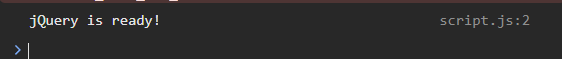

### Task 1. Selectors & CSS
Show name, headline, introduction and a "Welcome to My Portfolio" section. Use tag, ID and class selectors, change text with `.text()` and `.html()`, change styles with `.css()` and add light and dark theme buttons.

**Before changing the greeting**
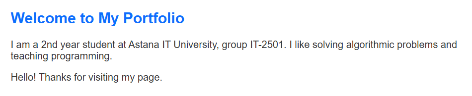

**After changing the greeting**
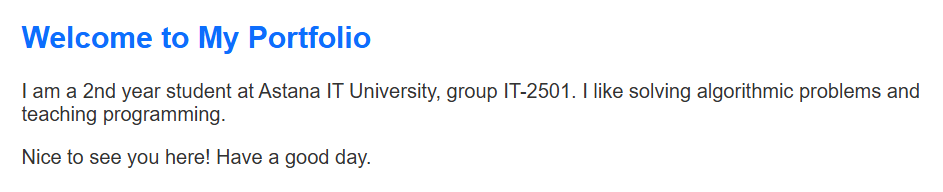

**Dark theme**
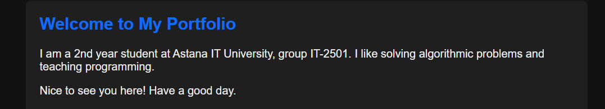

---

## Part 2. jQuery Effects

### Task 2. Visibility Methods
"About Me" section with a biography, a status message and fun facts. Hide, Show and Toggle buttons control the fun facts.

**Visible**
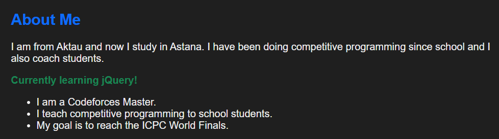

**Hidden**
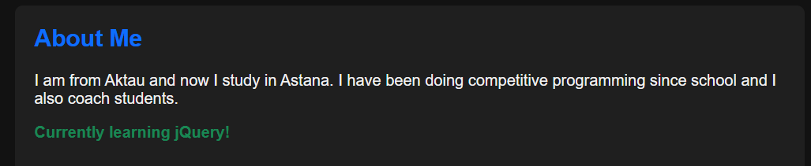

### Task 3. Fade Methods
Gallery with images controlled by `.fadeIn()`, `.fadeOut()` and `.fadeToggle()`.

**Visible**
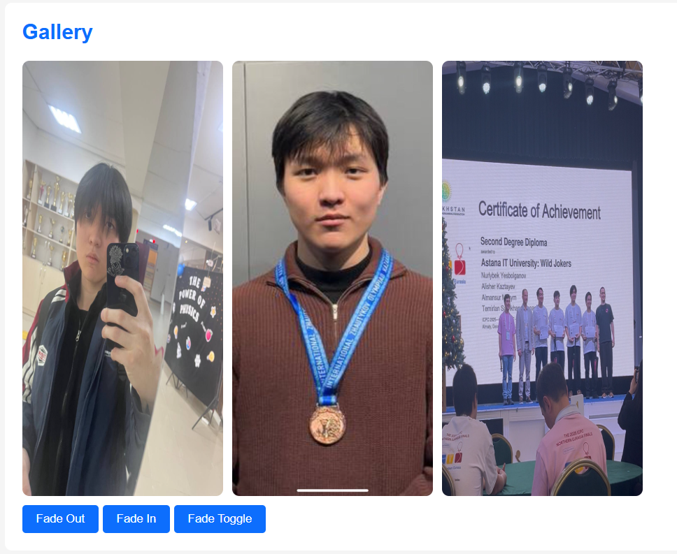

**After Fade Out**
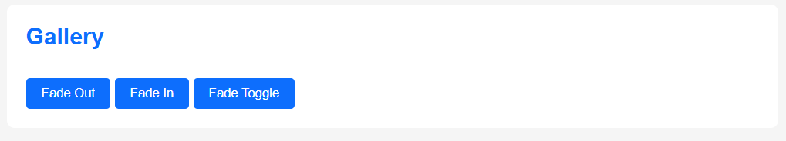

### Task 4. Slide Methods
Three clickable headings with collapsible panels using `.slideUp()`, `.slideDown()` and `.slideToggle()`.

**Closed**
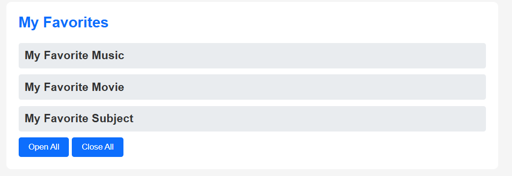

**Opened**
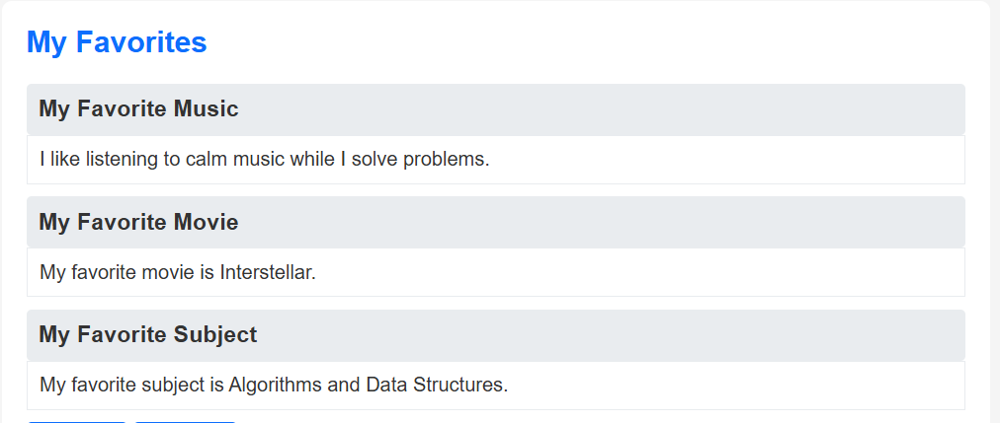

---

## Part 3. DOM Manipulation with jQuery

### Task 5. Add & Remove Elements
A list of skills with buttons "Add Skill", "Prepend Skill" and "Remove Skill" using `.append()`, `.prepend()` and `.remove()`. Empty skills are not added.

**After adding skills**
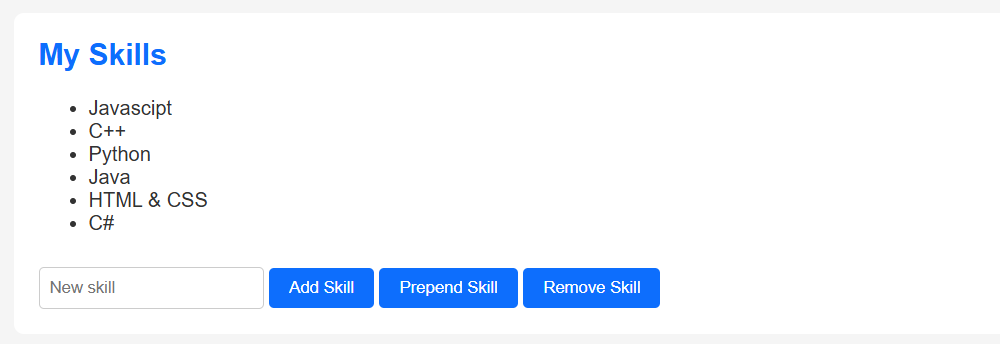

**Empty input**
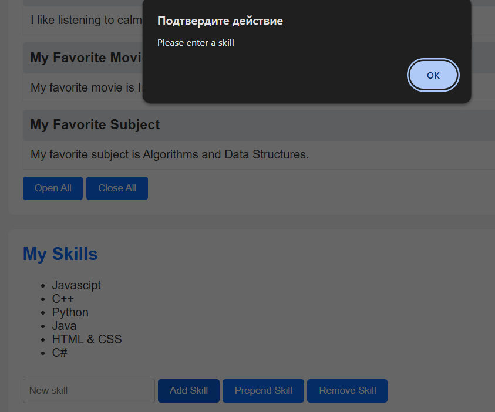

### Task 6. Modifying Attributes
A social media link that changes its destination with `.attr()`.

**Before**
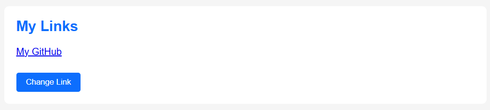

**After**
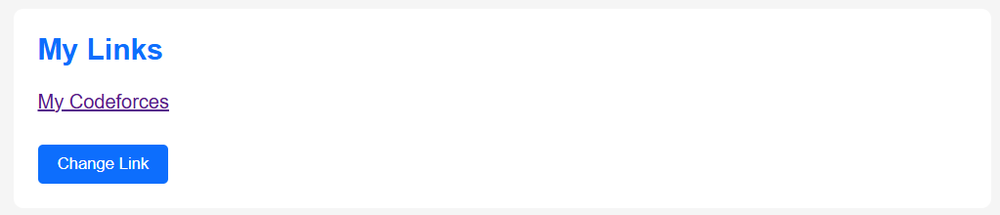

### Task 7. Form Interaction
A form with Name and Email. The input is shown live below the form with `.val()` and `.text()`.

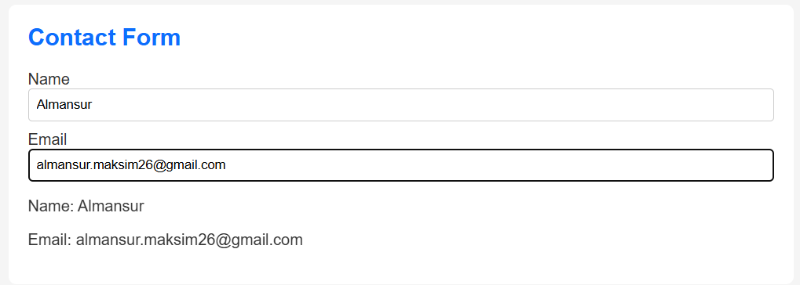

---

## Part 4. Animations

### Task 8. Basic Animation
Skill bars start with zero width. The "Animate My Skills" button uses `.animate()` to increase the width of each bar to a different level, and the next click animates them back to zero.

**Before**
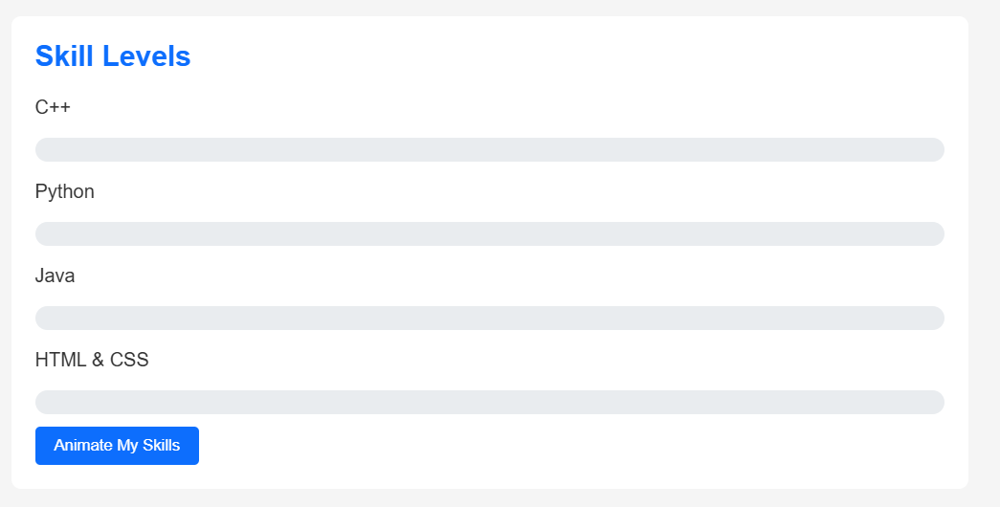

**After**
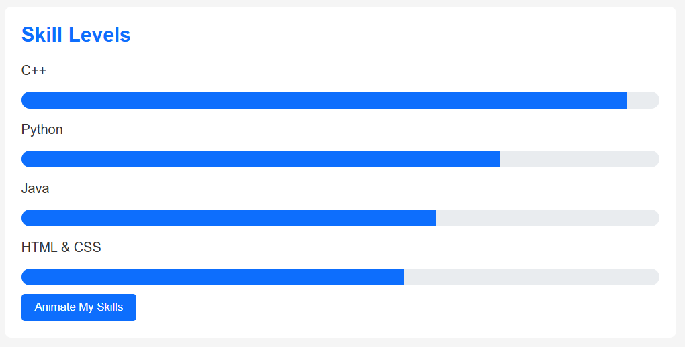

---

## Summary of work process

I made a one-page portfolio and connected jQuery from a CDN. All code is inside `$(document).ready()`, so it runs after the page is loaded, and it prints "jQuery is ready!" in the console.

In Part 1, I used tag, ID and class selectors to change styles with `.css()`, changed the greeting with `.text()` and the headline with `.html()`, and made light and dark theme buttons that change the background and text colors.

In Part 2, I used `.hide()`, `.show()` and `.toggle()` for the fun facts, `.fadeIn()`, `.fadeOut()` and `.fadeToggle()` for the gallery images, and `.slideUp()`, `.slideDown()` and `.slideToggle()` for the collapsible panels. A click on a heading opens or closes only the panel under it.

In Part 3, the skills list can be changed with `.append()`, `.prepend()` and `.remove()`, and an empty skill shows a message instead of being added. The link button changes the `href` with `.attr()`, and the form shows what the user types live with `.val()` and `.text()`.

In Part 4, the skill bars start with zero width and `.animate()` makes them grow to different widths. The second click animates them back to zero.

I tested every button in Chrome and checked the console for errors.
